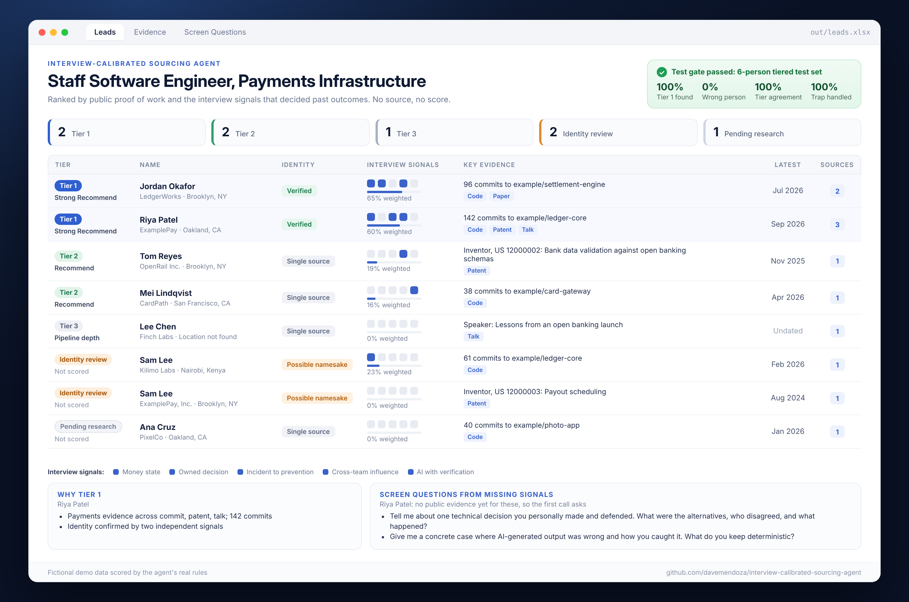
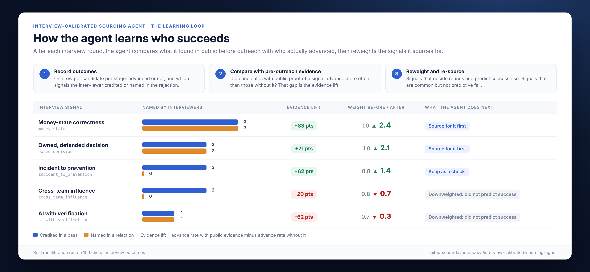

# Interview-Calibrated Sourcing Agent

**Open-web sourcing that learns from post-interview evaluations.**

> **New to this, or not technical?** Start with the [plain-English guide for talent leaders](docs/GUIDE_FOR_TALENT_LEADERS.md). It walks you through running your own version in six steps, or having Claude set it up for you.
>
> **[Download the calibration workbook (Excel)](https://github.com/davemendoza/interview-calibrated-sourcing-agent/raw/main/templates/Calibration_Workbook_TEMPLATE.xlsx)** to record your own interview signals, the people you have already rated, and interview outcomes. Fill in the yellow cells; the How to Use tab explains each step.

Most sourcing tools re-rank the same LinkedIn profiles every other recruiter sees. This agent finds engineers by the work they have done in public, then calibrates what it looks for using the signals that actually decided interview outcomes.

It started from a simple finding: when post-interview feedback for a Staff engineering loop was analyzed, candidates rarely failed the first question. They failed the follow-up. "What did you personally decide?" "What does the caller get when that payment call times out?" "How would you prove the AI output is correct?" Those deciding signals should be the first thing a sourcer looks for, and interview results should flow back into how leads are scored.



*What the agent returns, using fictional demo data scored by the agent's real rules. [Close-up: tiered leads](docs/images/leads-demo-closeup-tiers.png) · [Close-up: namesakes and screen questions](docs/images/leads-demo-closeup-identity-questions.png)*

## How it works

Two pages explain the parts most people ask about:
* [How the agent learns who succeeds](docs/HOW_THE_AGENT_LEARNS.md): the calibration workbook, the test gate, and how interview outcomes reweight signals.
* [Plain-English guide for talent leaders](docs/GUIDE_FOR_TALENT_LEADERS.md)
* [Build your ecosystem map](docs/BUILD_YOUR_ECOSYSTEM.md): where your job family leaves evidence, plus a prompt that drafts the map for any JD



```
 Stage 0  Interview calibration    signals that decided past interviews, with weights
    |
 Stage 1  Harvest the ecosystem    code, patents, papers, engineering blogs, packages, conference talks
          (taxonomy first)         standards and blog pages teach the agent the field's vocabulary
    |
 Stage 2  Identity gate            never merge on name alone; two independent signals required
    |
 Stage 3  Score evidence           met / not met / no evidence per requirement, each with a link
          (optional AI judge)      a model must quote the exact words that prove each signal
    |
 Stage 4  Output                   tiered leads, evidence sheet, screen questions for every gap
    |
 Stage 5  Test gate                must find your known Tier 1s and never mix up people
    |
 Stage 6  Recalibrate              interview outcomes adjust signal weights for the next run
    '------------------------------> back to Stage 0
```

### Stage 0: interview calibration
Each role file lists the interview signals that decide outcomes, with search terms, a weight and a screen question. The fintech example role uses five (the template keeps the four generic ones and leaves room for your own):

| Signal | What the interviewers listened for |
|---|---|
| `money_state` | Idempotency, unknown outcomes, timeouts, reconciliation |
| `owned_decision` | One decision the person made and defended, with alternatives and a result |
| `incident_to_prevention` | An incident told from detection through to process change |
| `cross_team_influence` | Influence through a mechanism: contracts, reviews, shared libraries |
| `ai_with_verification` | AI use with a concrete story of catching a wrong output |

A signal with public evidence raises the lead's signal score. A signal with no evidence becomes a specific screen question for that lead, so the recruiter screen closes gaps instead of repeating the resume.

### Stage 2: the identity gate
Evidence is first grouped by its own source (a GitHub account, a patent inventor in one city, an OpenAlex author, a conference speaker). Two groups with the same name merge only when a second signal agrees: the same employer, a link from one to the other's GitHub or website, the same self-published email, or the same metro with no conflicting employer. Same-name records that cannot be corroborated are marked **Identity review** and are never scored. This rule exists because name-only matching attaches one person's work to a namesake.

### Stage 3: scoring rules
Fail-closed: no evidence means no score.

| Rule | Why |
|---|---|
| No payments-domain evidence → **Pending research**, not a guessed tier | A missing signal is unknown, not zero |
| Domain evidence across 2+ channels, or 75+ seed-repo commits → **Tier 1** (Strong Recommend) | Proof from more than one place |
| One strong channel → **Tier 2** (Recommend) | Real, but thinner |
| Talk-only → capped at **Tier 3** | A talk alone is not checkable work |
| Patent-only → capped at **Tier 2** | Strong signal, little public code |
| Domain evidence older than `recency_years` → drop one tier | Old payments work is not current fit |
| Evidence follows the person | Payments work done at a former employer still counts |

### Optional: the AI judgment step
Keyword rules are fast and auditable, but a keyword is not proof. With `icsa run --judge` (and `ANTHROPIC_API_KEY` in `.env`), a model reads each keyword-flagged piece of evidence for Tier 1 and Tier 2 leads and decides whether it really shows the signal. It must quote the exact words that show it. A quote that is not in the evidence is rejected, so the model cannot invent proof. If the model says no, the signal goes back to "no evidence" and becomes a screen question. If the model is unreachable, the keyword result stands with a note saying so. The default model is Claude Haiku, which is enough for a short reading task like this and keeps cost low.

### Stage 5: the test gate
Before sourcing a role live, run the agent against people you have already tiered (20 Tier 1, 15 Tier 2, 10 Tier 3 and 5 traps is a good size). Traps are cases you have caught before: namesakes, people whose best evidence is old, strong titles with no checkable work. The gate fails if:

* fewer than 70% of your Tier 1s are found
* tier agreement is below 60%
* anyone is called Tier 1 that you did not rate Tier 1
* fewer than 80% of scored claims carry a source
* any wrong-person match is found, or identity has not been checked

### Stage 6: recalibrate from outcomes
After each interview round, add rows to the **Outcomes** tab of your calibration workbook ([template](templates/Calibration_Workbook_TEMPLATE.xlsx), saved as `data/calibration_workbook.xlsx`), or to `data/outcomes.csv` with the same columns:

```
name,stage,result,passed_signals,failed_signals
```

`result` is `advanced` or `not advanced`. Signal lists use the signal ids, separated by semicolons. `icsa recalibrate` then:

* raises the weight of signals interviewers named as the reason for a pass or a rejection
* raises signals whose public evidence (found before outreach) went with candidates who advanced, and lowers those that did not
* changes nothing until there are at least 5 outcomes

## Quick start

```bash
git clone https://github.com/davemendoza/interview-calibrated-sourcing-agent
cd interview-calibrated-sourcing-agent
python3 -m venv .venv && source .venv/bin/activate
pip install -e ".[dev]"
cp .env.example .env          # add GITHUB_TOKEN, PATENTSVIEW_API_KEY, OPENALEX_MAILTO
pytest                        # all tests use fictional people

icsa run                      # harvest, score, and evaluate if data/test_set.xlsx exists
icsa eval                     # re-run the test gate
icsa recalibrate              # after adding interview outcomes
```

Results land in `out/leads.xlsx` with three tabs: **Leads**, **Evidence** (every claim with its link) and **Screen Questions** (one per missing signal, Tier 1 and 2 only).

Run a single source with `icsa harvest --only github patents`.

### Nightly run (macOS or Linux)
```bash
crontab -e
# 2:17 AM every night
17 2 * * * cd $HOME/interview-calibrated-sourcing-agent && ./scripts/nightly.sh >> out/nightly.log 2>&1
```

## What it can't see

Be clear-eyed about coverage. Open-web evidence covers engineers who build in public: open-source contributors, patent inventors, paper authors and conference speakers. Many excellent engineers, especially in regulated industries like banking and payments, leave little or no public trace because their work is proprietary.

For those people this agent finds nothing, and by design it says "Pending research" rather than guessing. It is a complement to your existing sourcing, not a replacement:

* Use it to find the visible minority faster and with proof attached.
* Use its screen questions for everyone, including people you found elsewhere, so every first call tests the signals that decide your interviews.
* Use the calibration workbook even if you never run the code. Recording which signals decide your interviews is valuable on its own.

## Your first pilot

1. Fill in the calibration workbook's Test Set with people you have already rated, including a few traps.
2. Run `icsa run`, then mark Right person yes or no in `data/identity_review.csv` and run `icsa eval` again.
3. `icsa eval` ends with a one-sentence summary with no names in it, ready to share. For example: *"Found 9 of my 12 known Tier 1 engineers, kept 3 of 3 traps out of Tier 1, matched the wrong person 0% of the time, agreed with my tier 75% of the time, and surfaced 4 new Tier 1 or 2 leads I had not found."*

## Adapt it to your domain

The engine is domain-neutral. Everything specific to a field lives in a role file, and every line you are expected to change is marked `>>> CUSTOMIZE`.

| File | Use it for |
|---|---|
| `config/roles/TEMPLATE_role.toml` | Starting a new domain. Blank, with generic interview signals and every field to fill marked |
| `config/roles/example_fintech_staff_payments_engineer.toml` | A complete worked example from fintech (payments vocabulary, seed repos, patent assignees) |

What you can change without touching code:

* **Labels people see**, in the `[labels]` table: the domain name used in messages ("No payments evidence found yet"), the tier words (Strong Recommend, Recommend, Pipeline depth), and the status words (Pending research, Identity review).
* **Interview signals**: the follow-ups that decided your interviews, with search terms and a screen question.
* **Requirements**: your domain vocabulary. The `domain` requirement decides whether a lead is scored at all.
* **Sources**: seed repos, patent assignees, research institutions, conference events.

If a `>>> CUSTOMIZE` field is left empty, the agent prints a plain-language warning and scores nobody rather than guessing.

```bash
cp config/roles/TEMPLATE_role.toml config/roles/my_role.toml
icsa run --role config/roles/my_role.toml
```

## The ecosystem map

The agent only searches where you point it. Each role file has an **ecosystem map**: one `[[ecosystem]]` entry per place where people in the job family leave public evidence, tagged with how the agent may use it.

| Use | What it does |
|---|---|
| `harvest` | Finds new leads (GitHub repos, patent assignees, research institutions, Sessionize events, blog feeds that name authors, PyPI and npm packages) |
| `verify` | Confirms people already found (speaker, meetup and working-group pages). A name on a page never creates a lead by itself |
| `taxonomy` | Teaches the agent the field's vocabulary (rule books, standards, blogs without bylines). `icsa taxonomy` suggests terms you are missing |

```bash
icsa ecosystem     # coverage by category, and which categories are still empty
icsa taxonomy      # recurring phrases from your taxonomy pages that your role file doesn't cover yet
```

The fintech example maps code, patents, research, blogs, conferences, associations and standards for Staff payments engineers, with every URL checked. Meetups and packages are left for you to add, and `icsa ecosystem` says so. To build a map for your own job family, use [Build your ecosystem map](docs/BUILD_YOUR_ECOSYSTEM.md): a two-step method (company landscape, then each market's public footprint) and a copy-paste prompt for Claude.

## Sources and keys

| Channel | Source | Key needed |
|---|---|---|
| Code | GitHub REST API, contributors to mapped repos | Personal token (free) |
| Patents | PatentsView PatentSearch API (USPTO) | Free key |
| Papers | OpenAlex | None (email recommended) |
| Blogs | RSS and Atom feeds that name authors | None |
| Packages | PyPI and npm registry APIs | None |
| Talks | Sessionize public speaker JSON; other pages verify only | None |

## Data and privacy

* Everything about real people stays in `data/` and `out/`, which git ignores.
* Emails are recorded only when the person published them on their own profile or site.
* A name on a web page never creates a lead by itself.
* Every claim keeps its source URL so it can be checked, corrected or removed.

## Project layout

```
config/roles/          TEMPLATE_role.toml plus a fintech example; one file per role
docs/                  talent leader guide, how the agent learns, demo images
templates/             calibration workbook (Signals, Test Set, Outcomes, Signal Summary)
examples/              fictional outcomes that reproduce the learning-loop image
src/icsa/harvesters/   github, patents, openalex, talks (parse functions are pure and tested)
src/icsa/identity.py   identity gate
src/icsa/scorer.py     fail-closed tiering
src/icsa/judge.py      optional AI judgment step with quote verification
src/icsa/ecosystem.py  the ecosystem map: harvest, verify and taxonomy entries
src/icsa/taxonomy.py   suggests domain terms from taxonomy pages
src/icsa/evaluate.py   test gate against your tiered test set
src/icsa/recalibrate.py  learning from interview outcomes
tests/                 fictional fixtures only
```

## Roadmap

* An agent step that proposes new ecosystem entries from its best leads, for a person to approve
* Richer text for the AI judge (README files, design docs, talk abstracts)
* A skeptic pass that tries to disprove each Tier 1 before a person sees it
* Job-change monitoring for Tier 1 leads
* Trajectory scoring: how fast someone's scope is rising, not only where it is today

## License

MIT. Use it, adapt it to your own domain, and share it; keep the copyright notice. See [LICENSE](LICENSE).

Built by Dave Mendoza, Talent Engine.
