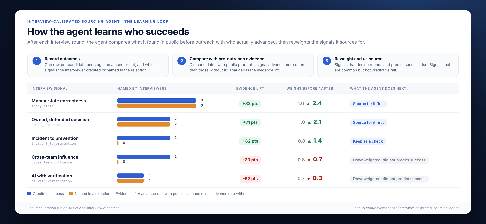

# How the Agent Learns Who Succeeds

The agent makes two comparisons. The first checks that it can be trusted before it sources anyone. The second learns, after every interview round, which signals separate candidates who advance from candidates who do not.

Both come from one place: the **calibration workbook** at [`templates/Calibration_Workbook_TEMPLATE.xlsx`](../templates/Calibration_Workbook_TEMPLATE.xlsx). Copy it to `data/calibration_workbook.xlsx` (that folder is never uploaded) and the agent reads it directly.



*A real recalibration run on 10 fictional interview outcomes. Reproduce it with the command at the bottom of this page.*

---

## The workbook at a glance

| Tab | You record | The agent uses it to |
|---|---|---|
| **Signals** | The follow-up questions that decided your past interviews, with a screen question for each | Know what to look for in public evidence before outreach |
| **Test Set** | 10 to 50 people you have already rated (Tier 1, 2, 3 or Trap), and later whether the agent matched the right person | Prove it finds your known strong people and never mixes anyone up |
| **Outcomes** | One row per candidate per interview stage: advanced or not, signals credited, signals that cost the round | Learn which signals predict success |
| **Signal Summary** | Nothing (all formulas) | Show, per signal, how often it was credited in passes and named in rejections |

Yellow cells are yours to fill in. The grey italic row on each tab is an example. Any row whose name starts with "Example" is ignored.

---

## Comparison 1: the test gate (before sourcing)

You rate people first. The agent runs without seeing your ratings. Then `icsa eval` compares the two:

| Check | Passes when |
|---|---|
| Tier 1 found | At least 70% of your Tier 1 people surfaced |
| Tier agreement | At least 60% of rated people got the tier you gave them |
| Over-ranked | Nobody called Tier 1 that you did not rate Tier 1 |
| Claims sourced | At least 80% of scored leads carry a link |
| Wrong person | 0% after you mark Right person yes or no |
| Traps | Traps never come out as Tier 1 |

If the gate fails, the agent tells you which check failed and does not source live.

## Comparison 2: the learning loop (after interviews)

For every signal, the agent measures two things.

**1. Decisiveness: did interviewers name it?**
It counts how often the signal was credited in a pass and named in a rejection on the Outcomes tab. A signal that keeps deciding rounds matters. The Signal Summary tab shows these counts as formulas, so you can see them without running anything.

**2. Evidence lift: did public proof predict success?**
For candidates the agent sourced, it already recorded whether public evidence of each signal existed *before* outreach. It splits them into two groups:

* candidates **with** public evidence of the signal
* candidates **without** it

and compares how often each group advanced:

```
evidence lift = advance rate with evidence  minus  advance rate without evidence
```

A large positive lift means the agent can spot that strength from the outside, so it should source for it first. A negative lift means the signal shows up in public but does not predict who succeeds, so the agent stops leaning on it.

**3. The new weight**

```
new weight = old weight x (1 + half the share of rounds it decided) x (1 + evidence lift)
```

Weights stay between 0.2 and 3.0, and nothing changes until there are at least 5 outcomes. The next scoring run uses the new weights, so leads with evidence for the signals that predict success rise to the top.

### Reading the example

| Signal | What happened | What the agent does |
|---|---|---|
| Money-state correctness | Decided 6 of 10 rounds; candidates with public evidence advanced far more often (+83 points) | Weight 1.0 to 2.4: source for it first |
| Owned, defended decision | Decided 4 rounds; strong lift (+71 points) | Weight 1.0 to 2.1: source for it first |
| Incident to prevention | Credited in passes, never in rejections; positive lift | Weight 0.8 to 1.4: keep as a check |
| Cross-team influence | Credited twice, but candidates with public evidence advanced *less* often (-20 points) | Weight 0.8 to 0.7: common in public, not predictive |
| AI with verification | Split result; public evidence went with candidates who did not advance (-62 points) | Weight 0.7 to 0.3: ask about it on the screen instead of sourcing for it |

That last row matters. A signal can be important in the interview and still be a poor sourcing signal, because what people post about AI publicly may not reflect how carefully they verify it. The agent keeps the screen question for that signal and stops ranking leads on it.

---

## Reproduce the example

```bash
icsa recalibrate \
  --outcomes examples/learning_loop/outcomes.csv \
  --matrix examples/learning_loop/signal_matrix.csv \
  --save /tmp/example_calibration.json
```

Both example files use fictional people.

## Small samples

Ten outcomes is enough to see direction, not enough to be sure. Treat early weights as a hypothesis, keep recording outcomes, and check the Signal Summary tab after each hiring round. The weight limits and the five-outcome minimum exist so that a handful of interviews cannot swing the agent too far.
